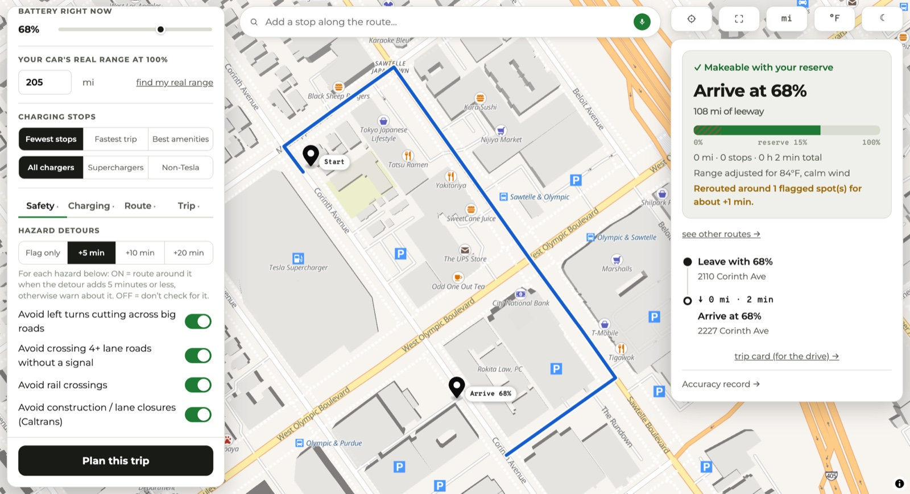

# Leeway

An EV road-trip planner for cars with degraded batteries that also spends a detour budget you set on routing around unprotected left turns, unsignaled crossings of 4+ lane roads and rail crossings.

[Live app](https://lyhjeremy.github.io/leeway/) · [Product overview](https://lyhjeremy.github.io/leeway/overview/) · [API health](https://leeway-api.onrender.com/api/health)

Design and copy follow [these standards](https://github.com/lyhjeremy/lyhjeremy/blob/main/DESIGN_STANDARDS.md).



*The second opinion before you leave.* Leeway plans trips across the mainland US from the range your car shows at 100% today; the factory figure doesn't come into it. I built it around a 2021 Tesla Model 3 Standard Range Plus that now shows 205 miles, down from 263 when new.

## What is different about it

The headline feature is hazard-aware rerouting. Four detectors each have their own switch: unprotected left turns, unsignaled crossings of 4+ lane roads, rail crossings, and active Caltrans lane closures (California only). A detour budget of 5, 10 or 20 minutes decides which of them get routed around and which only get flagged. Signals, lane counts and crossings come from OpenStreetMap geometry.

Battery degradation is the starting point for the range math, which begins from today's 100% range and adjusts for elevation per leg, live or forecast weather (temperature and headwind), and passenger and luggage load.

The app also grades itself. Log the arrival percentage you saw and Leeway keeps predicted against actual; after three substantial trips it applies a recency-weighted correction that leans to the safe side. A car that turns out hungrier than predicted gets the full adjustment, and one that does better gets only half, never below 0.9.

Stops can be asked for in plain language, by voice or text: "Add an In-N-Out after an hour of driving", or "a Starbucks with a drive-through that won't add much time". Each candidate is priced by a routed detour to the door and back.

Stack: React, Vite, TypeScript and MapLibre GL on GitHub Pages; FastAPI on Render (Docker, free tier); a Capacitor iOS shell. Data: OpenRouteService, Open Charge Map, Open-Meteo, Overpass/OSM, the US Census geocoder, Caltrans LCS and Gemini. 97 offline backend tests plus a vitest suite run in CI on every push.

> **The first search or plan of a session may take 30 to 60 seconds.** The backend runs on Render's free tier, which spins the instance down after 15 idle minutes, so the first request pays for the wake-up. The app says so while it waits. A `Backend uptime check` workflow probes it four times a day and reports failure only after about fifteen minutes without an answer across three tries.

## Features

- Reroutes around point hazards, each detector on its own switch, inside a detour budget (5, 10 or 20 minutes; 5 by default). It also warns, without rerouting, about steep descents, twisty sections, sun glare and strong wind.
- Plans charging stops with per-leg elevation-aware range math. An earlier version spread trip-wide climb data proportionally across legs and called I-5's Grapevine reachable when a per-leg check showed it was not; every candidate stop is now verified with a routing call before it is accepted.
- Adjusts range for live weather, load and an optional manual temperature. With a departure time set, weather comes from the hourly forecast for that hour (up to 7 days out), sun glare is computed for when you leave, and construction closures are filtered to those active on the road then.
- Learns your car from logged trips (described above), and the plan says when the correction is active.
- Charging preferences: fewest stops, fastest trip or best amenities; Superchargers only or non-Tesla only; specific networks (ChargePoint, Electrify America, EVgo, Tesla, Blink); a minimum charger speed; and a break rhythm ("stop at least every 2h") that plans stops for the driver when that binds before the battery does.
- A route editor with up to three stops between start and destination, searchable, drag to reorder, with route alternatives (I-5 against 101 against 99) to compare.
- Full-bleed map with floating cards, light and dark themes (dark has its own night basemap), and independent mi/km and °F/°C switches.
- Logs predicted against actual arrival per trip on your device and shows the running record on the accuracy page.
- Installable as a PWA, with a screenshot-friendly trip card for the drive.

## Structure

- `frontend/`: React, Vite, TypeScript, MapLibre GL; deployed to GitHub Pages by `.github/workflows/pages.yml` on every push to `frontend/**`.
- `backend/`: FastAPI on Render (Docker runtime, free tier). Render deploys it through its own GitHub integration from `render.yaml` at the repo root. `backend/README.md` explains why it is not on Hugging Face Spaces.
- `frontend/ios/`: the Capacitor iOS app (see below).
- `.github/workflows/`: Pages deploy, CI, and the uptime check.

## API keys and local development

The backend reads three keys from the environment. On Render they are set as service environment variables (`sync: false` in `render.yaml`); they are not in this repository.

| Variable | Used for | Without it |
|---|---|---|
| `ORS_API_KEY` | OpenRouteService routing, geocoding, elevation | `/api/geocode` and `/api/plan` return a clear 503 |
| `OCM_API_KEY` | Open Charge Map station lookup | Station lookup returns a 503 |
| `GEMINI_API_KEY` | Parsing voice and text stop requests (`GEMINI_MODEL` optional) | Natural-language stop search is unavailable |

```
cd frontend && npm install && npm run dev
cd backend && pip install -r requirements.txt && uvicorn app.main:app --reload --port 7861
```

`GET /api/health` returns the status and a version string that is bumped by hand whenever the backend changes, so a stale deploy is visible. Backend deploy steps (a Render Blueprint from `render.yaml`) are in [`backend/README.md`](backend/README.md).

## Tests

The backend suite (97 tests) runs fully offline against a faked provider layer: synthetic routes with configurable speed, elevation and highway mix, plus canned stations, weather, OSM and Caltrans data. It covers the range math, every safety-flag detector, the planner end to end including its failure notes, and the provider caches. The frontend's calibration math has its own vitest suite. CI runs both plus lint and build on every push.

```
cd backend && python -m pytest tests
cd frontend && npm test
```

## Data sources and caching

OpenRouteService (routing, geocoding, elevation), Open Charge Map (stations), Open-Meteo (weather), Overpass/OSM (POI search and hazard geometry), the US Census geocoder (exact house numbers Pelias lacks), Caltrans LCS (lane closures, California only) and Gemini (voice query parsing). Coverage is the mainland US. Successful provider responses are cached in-process (routes 6 hours, stations 30 minutes, weather 15 minutes) to stretch the free-tier quotas.

The public Overpass servers are the other scarce resource, and when they fail it shows up as latency, with no error. Measured against production, the three hazard queries alone turned a 2-mile plan into a 99-second one, because a mirror that accepts connections and then hangs costs a full timeout on every retry rotation. Timeouts are 5 seconds to connect and 20 to read, so a dead mirror is cheap. The planner gives each check 15 seconds before dropping it to no flags, and a circuit breaker stops asking for five minutes after three consecutive failures. A check that times out caches nothing, so without the breaker every later plan would pay again to discover the same outage. Safety flags are the one part of a plan allowed to go missing; a plan that never returns is worse than a plan without warnings.

Past 60 miles the hazard search is windowed. Spreading a fixed point budget over a whole route gave a 600-mile trip one point every four miles, so Overpass was asked about chords that cut corners by miles inside a 30 m buffer, and the near-empty result read as "safe". The search now runs only within 6 miles of each leg join (origin, every stop, destination), which is where surface-street hazards exist. Each window gets its own `around:` clause; concatenating them would have Overpass draw a corridor straight across the gap between two windows 200 miles apart.

## What constrains it

The free tier sets the ceiling. ORS allows 2,000 directions calls a day and **40 a minute**; a two-stop plan uses under ten, while a hard one in sparse country uses dozens. The minute limit binds first because its backoff outlasts Render's ~100-second proxy, so an unbounded plan would spend the quota and still end on "planning took too long". Three caps in `backend/app/planner.py` deal with it:

- `MAX_VERIFY_CALLS_PER_PLAN = 60`: past this the plan stops and says so instead of stalling.
- `MAX_STOPS = 10`: enough for 600 miles in a car down to about 150 miles of usable range, the driver this is for. A cap of six stops silently truncated that plan.
- `POINT_HAZARD_BUDGET_S = 15` per hazard check, after which it degrades to no flags.

Trips that need nine or ten stops will hit the minute limit and end with the rate-limit note. Ten stops cannot be verified in under 40 calls; paying for routing is what removes that limit.

Two lessons came from planning trips outside California:

- A chosen stop must advance the route by `MIN_STOP_PROGRESS_MI` (8 miles) and no station may be used twice. Without both, a Denver to Salt Lake City plan picked a charger at its own current position, charged to 80% and looped, using every stop slot and stalling at 360 of 520 miles. Charger density hid this in California.
- ORS refuses `avoid_polygons` past 150 km, and `_safe_directions` read the refusal as "no route". Since a 205-mile car runs 110 to 125 miles between stops, hazard avoidance was silently off on most legs of most trips. Legs over `ORS_AVOID_POLYGON_MAX_MI` (85 miles) are now split at points on their own geometry, and each piece is routed with the polygons in place.

## iOS app

The same frontend ships as a native iOS app, a Capacitor shell in `frontend/ios/` built with Swift Package Manager (no CocoaPods). It adds three things the website cannot do: a local-notification reminder to log how a planned trip went, the native share sheet for sending a stop to the Tesla app, and theme-matched status bar and safe areas. The built web bundle is committed, so building the app needs only Xcode. `IOS_HANDOFF.md` has the sign-and-ship steps; `npm run sync:ios` rebuilds the bundle and syncs it.

## A bug found during Stage 0

`maplibre-gl@6.0.0` (released 2026-07-25, the day this was built) loaded no vector tiles. The base style's raster hillshade layer rendered, but the vector `openmaptiles` source never issued a tile request, and nothing reported an error: `map.on('error')` stayed quiet and no network request failed. Pinning to `5.9.0` fixed it on the first retry. A `6.x` upgrade needs re-testing later, with a visual check that tiles render, because a silent failure like this one passes both build checks and console-error checks.

The product plan lives in `../LEEWAY_PRODUCT_PLAN.md`, one level up and outside this repository, which holds the code only.
